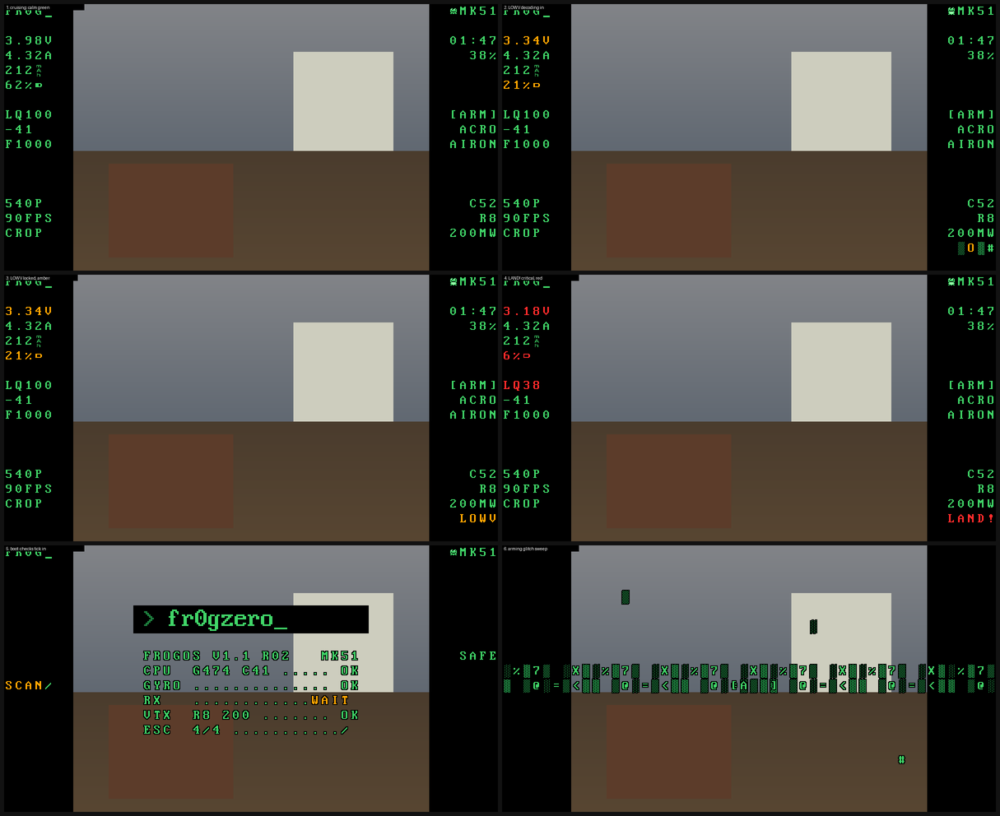
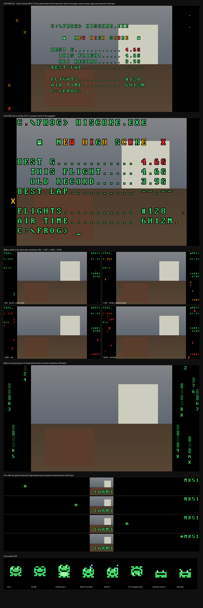

# fr0gOS

Custom Betaflight firmware and a unified OSD for the **fr0gzero** FPV fleet.
Strictly business by default, with a calm DOS-terminal look on HDZero: telemetry lives in the black bars, warnings decode in and climb from green to amber to red, and a little frog keeps an eye on things.





fr0gOS is a set of patches on top of **Betaflight 2026.6.2**.

## Fleet

| Craft | Quad | Board target | Video | Current build |
|---|---|---|---|---|
| MK4-1 | Air65 rebuild, BETAFPV Matrix 1S 5-in-1 II | `BETAFPVG473_V2` | Analog (Caddx Ant, NTSC 16:9) | v1.2 r03 |
| MK4-2 | Mobula 6 HDZero | `CRAZYBEEF4SX1280` + ELRS 4 SPI | HDZero Eco 720P60 4:3 | v1.3 r24 (test) |
| MK5-1 | Mobula 8, HDZero Whoop V2 + Nano 90 V2 | `CRAZYBEE473` | HDZero 540P90 crop | v1.3 r24 |

## What fr0gOS changes

**Every quad**
- Telemetry in two 5-character columns at the screen edges, grouped by category: power top left, link middle left, camera bottom left, time top right, state middle right, system bottom right.
- Column 0 is left-justified and the last column right-justified, whatever canvas width the FC assumes.
- No icons or unit glyphs: `4.09V`, `2.16A`, `LQ100`, `-33`, throttle icon + `45%`, `R8`, `200MW`, `C52`.
- Average motor RPM (`38K`), g-force (`2.1G`), ESC temp (`E48`) and lifetime flight count (`#127`).
- Camera mode as plain text lines, set per quad from the CLI (`osd_custom_msg0`-`3`, e.g. `540P` / `90FPS` / `CROP`). Unset lines show nothing.
- New elements: live ELRS packet rate (`F1000`, `D500`...), battery %, air mode (`AIR` when on, blank when off) on its own line, separate flight mode (`ACRO` / `ANGLE` / `HORZN`).
- `[ARM]` / `SAFE` always shown. Every warning fits 5 characters (`LOWV`, `LAND!`, `FSAFE`, `RXLOS`, `TURTL`, `HOT70`...).
- BIOS-style boot screen with real checks (CPU, gyro, receiver, VTX, ESC telemetry, battery) that tick in one at a time. The receiver shows `WAIT` until the radio links.
- Arming plays a glitch sweep, then `[ARM]` decodes in.
- Post-flight `HISCORE.EXE`: best G (this flight and the old record), a `BEST LAP` placeholder for the coming lap timer, lifetime flights and air time. A new record gets a decoding, colour-chasing `NEW HIGH SCORE` banner with hopping frogs and fireworks.
- Battery noise creeps into the black bars in four stages: SAG green, LOW amber, LAND red, DEAD red flood.
- Matrix rain screensaver in the bars after 5 s disarmed and still. Any stick brings the OSD back.
- Boot lines type out with a cursor, with an uptime and flight count line. Battery % charges up when the OSD comes on.
- OSD at 20 fps.
- New warnings decode in from noise, one character at a time.
- Flipping a switch (flight mode, air mode, packet rate, VTX power) makes the new text decode in with a colour chase. Live numbers don't.
- Default rates: Betaflight, roll/pitch 0.65 / 0.74 / 0.10, yaw 0.55 / 0.74 / 0.10.

**HDZero with the hacker font** (`osd_frog_hd_font = ON`)
- IBM VGA 8x16 DOS font in phosphor green with a black outline.
- Per-character colour: normal is green, warning is amber, critical is red. HDZero only gives Betaflight one 256-glyph bank, so the font carries amber and red copies of the alphabet.
- The frog (80 glyphs of it) lives on ledges above the readout groups and hops between them, off the screen edge and back in on the new row. It reacts to what you do (arm, disarm, mode changes, punch-outs, flips, rolls, spins, crashes, new records), rolls onto its back when the quad is upside down, squashes under high G, and runs to the voltage to jump up and down on low battery. See `CHANGELOG.md` (v1.3 r09).
- Battery bar glyph after the %, and a `SCAN` spinner until the receiver links.
- Boot: the frog powers on like an old CRT and hops along the boot header while the checks run, then celebrates.

New CLI settings: `osd_frog_tag_pos`, `osd_frog_craft_pos`, `osd_frog_air_pos`, `osd_frog_rate_pos`, `osd_frog_batt_pos`, `osd_frog_vtxpwr_pos`, `osd_frog_noise_pos`, `osd_frog_hd_font`, and `osd_custom_msg0`-`3` with `osd_custom_msg0_pos`-`3_pos`.
Configurator doesn't know these elements, so position them from the CLI.

## Flashing a quad

1. **HDZero quads only:** copy `fonts/hdzero-hacker/BTFL_000.bmp` and `BTFL_FHD_000.bmp` to `resource/OSD/FC/` on the goggle SD card. The r09 font carries the full frog set in place of the boot logo; fr0gOS builds before v1.3 r09 still run on it but show the wrong frog and logo glyphs.
2. Save a `diff all` backup first.
3. Flash `builds/<quad>/<hex>` with **Full chip erase** ticked (Firmware Flasher, Load Firmware [Local]).
4. Paste `quads/<quad>/fr0gOS_cli_*.txt` into the CLI.
5. Recalibrate the accelerometer.

The MK4-2 CLI here has its ELRS binding UID removed. Use your private copy, or set your own binding UID.

## Building from source

```sh
git clone --branch 2026.6.2 --depth 1 https://github.com/betaflight/betaflight.git
cd betaflight
git submodule update --init --depth 1 src/config
git apply ../patches/fr0gOS-v1.3-r24_betaflight-2026.6.2.patch
make arm_sdk_install            # or point ARM_SDK_DIR at GCC 13.3.1
make CONFIG=CRAZYBEE473
make CONFIG=BETAFPVG473_V2
make CONFIG=CRAZYBEEF4SX1280 EXTRA_FLAGS=-DUSE_ELRSV4   # built-in SPI receiver must speak ELRS 4
```

`patches/history/` keeps the step-by-step patches. Regenerate the HDZero font and its firmware charmap with `tools/build_hacker_font.py`. `tools/make_hd_cli.py` turns a quad's `diff all` into a fr0gOS HDZero CLI with the shared OSD block. `tools/preview_osd.py` and `tools/preview_v12.py` render what the goggles should show.

## Layout

```
builds/<quad>/        hex files (old/ = superseded)
quads/<quad>/         diff all backups and fr0gOS CLI files
patches/              cumulative patch against Betaflight 2026.6.2 (+ history/)
fonts/hdzero-hacker/  HDZero hacker goggle font (v1.2)
fonts/hdzero/         earlier HDZero font with the two-line logo (v1.0)
logos/                analog 288x72 and HDZero boot logo designs
tools/                font builder, CLI generator, OSD preview
```

## Licences

- Firmware patches, builds and tools: **GPL-3.0**, same as Betaflight (see `LICENSE`).
- `fonts/hdzero-hacker/`: text glyphs are "IBM VGA 8x16" from [The Oldschool PC Font Resource](https://int10h.org/oldschool-pc-fonts/) by VileR, **CC BY-SA 4.0**, via [susam/pcface](https://github.com/susam/pcface). Symbol glyphs come from the stock HDZero Betaflight font ([hd-zero/hdzero-goggle](https://github.com/hd-zero/hdzero-goggle)).
- ELRS packet-rate names follow ExpressLRS 4.x `expresslrs_RFrates_e`.

Not affiliated with Betaflight, HDZero or ExpressLRS. Flash at your own risk and always keep a `diff all`.
